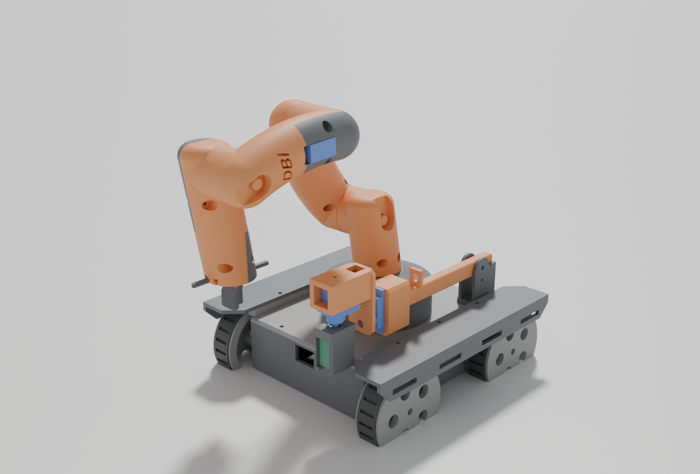

# Robot Arm Tank

A compact 4WD skid-steer tank carrying a scaled-down "P-P 1.2" planetary-gear robot arm by DBI, with a rack-and-pinion gripper, and a pan-tilt Wi-Fi camera on a mast that folds down for carrying. I shrank the arm to 32/58 (about 55%) so all its joints run on mini servos, and it is driven from a Bluetooth gamepad through an ESP32, with the camera video on a phone. No soldering is needed to wire it, and folded it measures about 24 x 18 cm and 21 cm tall. The hull is modelled in CadQuery and the robot is rendered in Blender.

Built by Gio ([Built-By-Gio](https://github.com/Built-By-Gio)).

The arm is the "P-P 1.2" planetary-gear robot arm by DBI (Dynabot Innovations), original design: https://cults3d.com/en/3d-model/gadget/3d-druckbarer-roboterarm-mit-planetengetrieben-p-p-1-2-arduino-esp32-rpi-compat ; DBI's original files and my scaled versions are included here with DBI's permission (2026-11-26).



## Status (2026-11-26)

**I have designed this version but not built it yet. My VANTA hexapod comes first.**

- In this repo, in `pp12-arm-version/`: DBI's 14 original STL files, my 14 scaled arm parts, the camera mast parts (mast, mast base, knob), the hull and mast as a STEP file, two build guides (a step-by-step setup and assembly guide and a 12-phase checklist page) and a 44-second build animation.
- Checked in CAD: when I last ran `pp_mini.py` (October 2026) it found no clashes at home, every joint clear at its limits, base yaw +-80 deg clear, a clear camera view of the fingertips and of the floor ahead, and a clear mast fold.
- Not built yet: nothing is printed, wired or driven, and I have not bought the parts.
- Not checked yet: the E-clip size for the joint shafts.

Still to add (not in this repo yet):
- The firmware for this version. The sketches in `firmware/` belong to the earlier lattice-arm design.
- The CAD scripts `pp_mini.py` depends on (the matching `tank.py` and `build.py`), and separate STL files for this version's hull parts. Right now the hull parts are inside `pp12-arm-version/robot_arm_tank_hull.step`.
- The later bus-servo variant of this arm.

## What you need

From the parts table in `pp12-arm-version/build_guide/1_SETUP_AND_ASSEMBLY.md`:

| Part | Qty | Goes where |
|---|---|---|
| ESP32-WROOM-32U DevKitC (+ antenna) | 1 | tank controller, talks to the gamepad |
| XIAO ESP32-S3 Sense (camera + board) | 1 | camera on the mast |
| 6dBi antenna + U.FL pigtail | 2 | 1 on the camera (1 spare) |
| MG90S servo | 6 | base, elbow, wrist, claw, camera pan, camera tilt |
| SG90 servo | 1 | shoulder |
| PCA9685 servo board, headers pre-soldered | 1 | drives all 7 servos |
| 6705ZZ bearing | 7 | 2 per arm joint + 1 in the base top |
| Servo extension cables | as needed | arm and mast servo leads |
| ZK-5AD motor driver | 1 | drive motors |
| XL4015 buck converter | 1 | battery 7.4 V to 5.1 V |
| USB-C screw-terminal adapter | 1 | powers the camera |
| Samsung 25R 18650 | 2 | battery |
| 2S 18650 holder | 1 | battery |
| KCD1 pre-wired switch | 1 | power switch |
| 3-port lever connectors | ~6 | all power joins |
| E-clips (assortment) | 3 | one per arm joint shaft |
| TT motors with leads | 4 | wheels |
| M3 screws + nuts, Dupont jumpers, velcro, foam tape, 1000uF cap | assorted | |
| PS5 DualSense, phone | | control + video |

Tools: a 3D printer (PLA + TPU), side cutters, a small Phillips screwdriver, a 2.5 mm hex key, a data USB-C cable, a PC with the Arduino IDE, and an 18650 charger.

Estimated cost: about $134 to buy, if you already have the gamepad, PCA9685, TT motors and filament (from my build notes for this version). Nothing is bought yet.

Software: the Arduino IDE with the ESP32 + Bluepad32 board package and the Adafruit PWM Servo Driver library. To re-run `pp_mini.py`: Python 3 with CadQuery, trimesh, manifold3d, rtree and shapely.

## How to build

Follow `pp12-arm-version/build_guide/1_SETUP_AND_ASSEMBLY.md` top to bottom, with DBI's own instructions next to it (they come with DBI's files). `pp12-arm-version/build_guide/2_BUILD_PROCESS.html` is the same build as a checklist you can tick off in a browser, and `3_BUILD_VIDEO.mp4` shows the assembly order. In short:

1. Print the scaled arm parts from `pp12-arm-version/stl/` and the tank parts.
2. Set up the firmware and pair the gamepad (the firmware for this version is still to add, see Status).
3. Build the hull and wire it with lever connectors and jumpers (no solder).
4. Prepare the servos at 90 deg, then build the base, the three arm joints and the claw.
5. Mount the camera mast, close the lid and run the final checks.

These steps are my plan for the build. I have not done them on real hardware yet.

## Earlier design: lattice-boom arm

Before switching to the P-P 1.2 arm I designed my own arm for the same tank: a 5-DOF lattice-boom arm with a standard-size 20 kg servo on the shoulder, a slim rack-and-pinion gripper and a faceted turret, with the pan-tilt camera on a tower on the rear-left fender. Stowed, it packs into roughly 20 x 18 x 21 cm including wheels. All of it is at the repo root (`source/`, `stl/`, `firmware/`, `images/`, the STEP and the `.blend`), and the parts are modelled in CadQuery.


### Status of the lattice-arm design (2026-11-25)

- Done: the full CAD model (`source/tank.py`), the print-ready STL files in `stl/`, an assembled STEP file and Blender scene, a parts list, a no-solder wiring plan and two firmware sketches (tank drive + arm, and the camera). Renders are in `images/`.
- Range of motion in the CAD model: shoulder -15 to 150 deg, elbow -130 to 120, wrist +-120, gripper 0-40 mm. `source/build.py` also runs an interference check between parts.
- Not built yet: nothing is printed, wired or driven.
- Not compiled yet: the firmware.
- The parts list is my shopping list. Prices are estimates from example listings, and I have not bought anything for it yet.
- A Blender build animation (about 2 minutes, 1080p) exists but is not in this repo because the file is about 35 MB. `source/video.py` makes it again from `robot_arm_tank.blend`.

### What you need (lattice arm)

#### Not in the price list (assumed on hand)

4x TT gear motors, a PCA9685 16-channel servo driver, one standard-size 20 kg shoulder servo (DS3218 / MG996R class) with a 25T aluminium disc horn, PLA and TPU filament, and a Bluetooth gamepad (PS4, PS5 or Xbox style, supported by Bluepad32). An 18650 charger is also needed if you do not have one (estimated ~$15 more).

#### Shopping list (estimated prices, not bought)

Links are example listings, not endorsements; prices change.

| Part | Est. price | Example listing | Check |
|---|---|---|---|
| ESP32-WROOM-32**U** DevKitC | $9-16 | [single](https://www.amazon.com/ESP32-DevKitC-Board-ESP32-Development-ESP32-WROOM-32U/dp/B09NGM7PPK) or [HiLetgo 2-pack](https://www.amazon.com/HiLetgo-ESP32-DevKitC-ESP32-WROOM-32U-Development/dp/B09KLS2YB3) | "32U" (antenna jack), headers already soldered |
| XIAO ESP32S3 **Sense** | $15-20 | [Seeed, pre-soldered](https://www.amazon.com/Seeed-Studio-ESP32S3-Sense-Pre-Soldered/dp/B0DRNW6KMG) | Sense = camera board included |
| 2x 3dBi SMA antenna + 15cm U.FL pigtails | $9 | [10Gtek 2-pack](https://www.amazon.com/10Gtek-2-4GHz-RP-SMA-antenna-pigtail/dp/B09K3ZPY5Z) | pigtail and antenna must match (both SMA or both RP-SMA) |
| 30cm U.FL to SMA pigtail | $7 | [Bingfu 30cm 2-pack](https://www.amazon.com/clp/B07YCBQF89) | camera head to the right-rear fender antenna; 15cm is too short |
| 6x MG90S servos | $13 + $7 | [Beffkkip 4-pack](https://www.amazon.com/Beffkkip-Helicopter-Servos-Arduino-Project/dp/B07L6FZVT1) + a 2-pack (or 2x SG90 for the camera) | base, elbow, wrist, gripper, pan, tilt |
| Servo extension cables 30cm | $6 | [search](https://www.amazon.com/s?k=servo+extension+cable+30cm+10+pack) | arm and camera servo leads don't reach the PCA9685 without them |
| ZK-5AD dual motor driver | $8 | [EC Buying 2-pack](https://www.amazon.com/EC-Buying-Controller-Stepper-Control/dp/B0CPJGHMXJ) | input header pins pre-soldered |
| XL4015 5A buck converter | $9 | [MakerCircuit, with display](https://us.amazon.com/MakerCircuit-XL4015-Converter-Display-Adjustable/dp/B0H2HGBXL1) | pick a version with **screw terminals** |
| USB-C male to screw terminal | $7 | [Teansic 5-pack](https://www.amazon.com/Teansic-Type-Screw-Terminal-Adapter/dp/B0FDKC97CY) | powers the XIAO |
| 2x 18650 cells, real brand | $12-18 | [Samsung 25R search](https://www.amazon.com/samsung-25r-18650/s?k=samsung+25r+18650) | fakes are common |
| 2S 18650 holder with leads | $7 | [LBTODH 2-pack](https://www.amazon.com/LBTODH-Battery-Holder-Storage-Plastic/dp/B092TGS4FP) | 2 slots in **series** (7.4V) |
| KCD1 rocker switch, pre-wired | $7 | [APIELE 5-pack](https://www.amazon.com/Toggle-Switch-Design-Automotive-Pre-Wired/dp/B0D1MDXP2G) | front-wall cutout is 13 x 19mm |
| WAGO 221-413 lever nuts | $9 | [10-pack](https://www.amazon.com/WAGO-221-413-Lever-Nuts-3-Conductor-Connectors/dp/B07W94XJSN) | |
| M3 screw + nut kit | $12 | [440pc socket head kit](https://www.amazon.com/Stainless-Steel-Socket-Screws-Assortment/dp/B01N3YT1OZ) | needs 8, 10, 16mm lengths |
| Dupont jumpers F-F and M-F | $7 | [search](https://www.amazon.com/s?k=dupont+jumper+wires+female+female+male+female) | |
| Velcro strips + 2mm foam tape | $5 | [search](https://www.amazon.com/s?k=velcro+strips+adhesive+small) | |
| 1000uF 10V+ capacitor | $1-8 | [search](https://www.amazon.com/s?k=1000uf+16v+electrolytic+capacitor) | goes in the PCA9685 V+ terminal |
| **Estimated total** | **~$150-165** | | |

#### Software

- Python 3 with [CadQuery](https://github.com/CadQuery/cadquery) (only to regenerate the CAD files).
- [Blender](https://www.blender.org/) (only to rebuild the scene, renders or animation; the animation script was used with Blender 5.2).
- Arduino IDE with the ESP32 + [Bluepad32](https://github.com/ricardoquesada/bluepad32) board package, the standard esp32 board package (for the XIAO), and the Adafruit PWM Servo Driver library.

Still to add: the exact CadQuery, Arduino core and library versions.

### How to build / run (lattice arm)

These steps are my plan for the build. I have not done them on real hardware yet.

1. **Print the parts** from `stl/` (already laid flat):

   | File | Qty | Material | Notes |
   |---|---|---|---|
   | tub, lid | 1 each | PLA | |
   | fender | 2 | PLA | mirror one in the slicer |
   | clamp | 2 | PLA | |
   | turret | 1 | PLA | octagon down, supports off |
   | upper_arm, forearm, wrist | 1 each | PLA | 4 walls, 15% infill |
   | gripper_housing | 1 | PLA | back face down, no supports |
   | pan_base, pan_yoke, cam_head | 1 each | PLA | flat side / plate / horn plate down |
   | jaw_a, jaw_b | 1 each | PLA | 0.12mm layers, flat side down |
   | pinion | 1 | PLA | 0.12mm layers, 100% infill, elephant foot compensation on |
   | wheel | 4 | PLA | skip if you use the stock TT wheels |
   | tire | 4 | TPU | |

2. **Measure your 20 kg servo** before printing the turret and upper arm. `source/tank.py` assumes a 40.5 x 20.2 mm body, tabs 26.5 mm above the bottom, spline top 14 mm above the tabs, holes 49.5 x 10 mm, and a 25 mm disc horn with 4 M3 holes on an 8.5 mm radius. If yours differ, change `STD_*` / `DISC_*` and regenerate (step 8). A 270-degree servo needs a different firmware mapping.

3. **Wire it (no solder):**

   | From | To |
   |---|---|
   | Battery + | switch -> Wago -> ZK-5AD VCC, XL4015 IN+ |
   | Battery - | Wago -> ZK-5AD GND, XL4015 IN- |
   | XL4015 OUT (set to **5.1V before** connecting) | Wago -> PCA9685 V+, ESP32 5V pin, USB-C adapter (XIAO) |
   | XL4015 OUT- | Wago -> PCA9685 GND, ESP32 GND, USB-C adapter GND |
   | ESP32 3V3 / GND / GPIO21 / GPIO22 | PCA9685 VCC / GND / SDA / SCL |
   | ESP32 GPIO25 / 26 | ZK-5AD IN1 / IN2 (left motors) |
   | ESP32 GPIO27 / 33 | ZK-5AD IN3 / IN4 (right motors) |
   | ZK-5AD MOTOR-A / MOTOR-B | both left motors in parallel / both right motors in parallel |
   | Servos base / shoulder / elbow / wrist / gripper | PCA9685 ch 0 / 1 / 2 / 3 / 4 |
   | Servos camera pan / tilt | PCA9685 ch 5 / 6 (30cm extensions) |
   | ESP32 U.FL | pigtail -> SMA bulkhead in the lid's rear-left hole |
   | XIAO U.FL | 30cm pigtail -> SMA bulkhead in the right fender's rear hole |

   Bay layout (velcro): battery holder along the rear, XL4015 and ZK-5AD on top of it, ESP32 front-left pins-up, PCA9685 front-right. Flash the ESP32 with the lid off.

4. **Flash the tank** (`firmware/arm_tank`): in the Arduino IDE add the board URL `https://raw.githubusercontent.com/ricardoquesada/esp32-arduino-lib-builder/master/bluepad32_files/package_esp32_bluepad32_index.json`, install **ESP32 + Bluepad32**, pick *ESP32 Dev Module*, install **Adafruit PWM Servo Driver**, flash.

5. **Flash the camera** (`firmware/camera`): first open `camera.ino` and replace `CHANGE_ME` on line 8 with your own password (at least 8 characters). Then use the standard esp32 board package, board *XIAO_ESP32S3*, PSRAM *OPI PSRAM*, and flash. On the phone, join the Wi-Fi network `armtank-cam` with that password and open `http://192.168.4.1`.

6. **Assemble:**
   - Horns: boot with the servos plugged in and horns off, so everything goes to 90. Fit the base with the turret facing forward, the shoulder with the upper arm ~45 deg up, the elbow with the forearm at 90 deg to it, and the wrist in line with the forearm. Then check that STOW (B) folds the arm over the hull; flip any value around 90 that goes the wrong way.
   - Shoulder: the disc horn bolts to the upper arm's big cheek (4x M3x8); the other cheek rides on an M3 screw in the cradle's back wall.
   - Camera: the pan servo sits in the top of the 48 mm tower on the rear-left fender (2x M3 through the fender), shaft up. The yoke goes on its horn and carries the tilt servo; the camera head goes on the tilt horn. The XIAO drops into the head from the top, lens to the front window, USB-C out the side slot.
   - Motors: drop in with the shaft in the wall slot and the gearbox end under the end lip, then screw the clamp (foam tape under it) onto the post just inboard of them, before the lid goes on.
   - Gripper: cut its horn to the hub plus a ~2 mm stub, servo in from the front, power to 90, gear on, fingers in from the sides at ~20 mm gap, then bolt to the wrist flange (4x M3x16) before the wrist goes on the forearm.

7. **Drive it:**

   | Input | Does |
   |---|---|
   | Left stick | drive |
   | Right stick X / Y | base / shoulder |
   | L1 / R1 | elbow |
   | D-pad up / down | wrist |
   | L2 / R2 | gripper close / open |
   | Triangle / Y | arm home |
   | Circle / B | stow for carrying |
   | D-pad left / right | camera pan |
   | Square / Cross (X / A on Xbox) | camera tilt up / down |
   | R3 (right stick click) | camera recenter |

   Stow is for carrying; for driving keep the arm up and forward.

8. **Regenerate the CAD (optional):** `cd source` then `python build.py ..`. This rewrites `stl/`, `robot_arm_tank_assembly.step` and a `_mesh/` folder of assembly meshes, and prints any part clashes. Set the environment variable `POSE=stow` for the stowed pose.

9. **Rebuild the Blender scene and renders (optional), from the repo root:** `blender -b -P source/render.py -- _mesh images/render iso,side,camera robot_arm_tank.blend`. The build animation: `blender -b robot_arm_tank.blend -P source/video.py -- <out_prefix>`.

## Repo layout

```
README.md                      this file
IDEAS.md                       future ideas, mainly camera tracking for the arm
LICENSE                        MIT (my own design and code, see Credits and license)
pp12-arm-version/              CURRENT DESIGN: the tank with the scaled P-P 1.2 arm
  pp12/                        DBI's 14 original STL files, unchanged
  pp_mini.py                   scales and refits DBI's parts, runs the CAD checks
  stl/                         14 scaled arm parts (arm_*.stl) + camera mast parts (mast, mast_base, knob)
  robot_arm_tank_hull.step     hull + camera mast for this version
  build_guide/                 setup and assembly guide, checklist page, 44 s build animation
  images/render_folded.png     render of this version

Earlier design (lattice-boom arm):
robot_arm_tank.blend           assembled robot in Blender (servos, motors, boards as stand-in blocks)
robot_arm_tank_assembly.step   assembled robot as STEP, made by source/build.py
images/                        renders: iso, side and camera views
stl/                           17 print-ready parts, made by source/build.py
source/tank.py                 parametric CAD for every part (CadQuery)
source/build.py                exports STLs and the STEP assembly, runs the interference check
source/render.py               Blender: imports the meshes, renders views, saves the .blend
source/video.py                Blender: build animation
firmware/arm_tank/             ESP32-WROOM-32U: Bluepad32 gamepad, PCA9685 servos, ZK-5AD drive
firmware/camera/               XIAO ESP32S3 Sense: own Wi-Fi network, MJPEG stream page
```

## Roadmap / future plans

- Add the firmware for the P-P 1.2 version, the CAD scripts `pp_mini.py` depends on, and the later bus-servo variant.
- Build it, after the VANTA hexapod is finished: print, wire, compile and test the firmware.
- A phone holder for the gamepad so the camera video can be watched while driving (not designed yet).
- Camera tracking for the arm, in stages (details in `IDEAS.md`, written for the lattice arm):
  1. The camera follows a target with pan/tilt (colour blob or ArUco/AprilTag, detection on the phone or on the XIAO).
  2. Send the tracking result to the tank's ESP32 (ESP-NOW, or a UART fallback).
  3. Turn "where the camera looks" into "where the arm reaches" (floor intersection plus inverse kinematics).
  4. Final approach and grab, using a tag on the gripper.
  5. Extras: tap to grab, follow-me mode, record and replay arm moves.
- Other ideas: joint angle feedback, soft start for the servos, a battery gauge.

## Credits and license

The arm is the "P-P 1.2" planetary-gear robot arm by DBI (Dynabot Innovations), original design: https://cults3d.com/en/3d-model/gadget/3d-druckbarer-roboterarm-mit-planetengetrieben-p-p-1-2-arduino-esp32-rpi-compat ; DBI's original files and my scaled versions are included here with DBI's permission (2026-11-26).

DBI's programs for their arm: https://github.com/DynaBotInnovations/Roboter-Arm-P-P-1.0-Bus-Servo

Tank, camera mast, lattice-boom arm, CAD scripts and firmware by Gio. Uses [CadQuery](https://github.com/CadQuery/cadquery), [Blender](https://www.blender.org/), [Bluepad32](https://github.com/ricardoquesada/bluepad32), the Adafruit PWM Servo Driver library and the Espressif ESP32 Arduino core; none of them is included in this repo.

License: my own design and code are released under the MIT License, see `LICENSE`. DBI's files in `pp12-arm-version/pp12/` and the parts derived from them (`pp12-arm-version/stl/arm_*.stl`) are not covered by the MIT License; they stay under DBI's terms and are shared here with DBI's permission.
